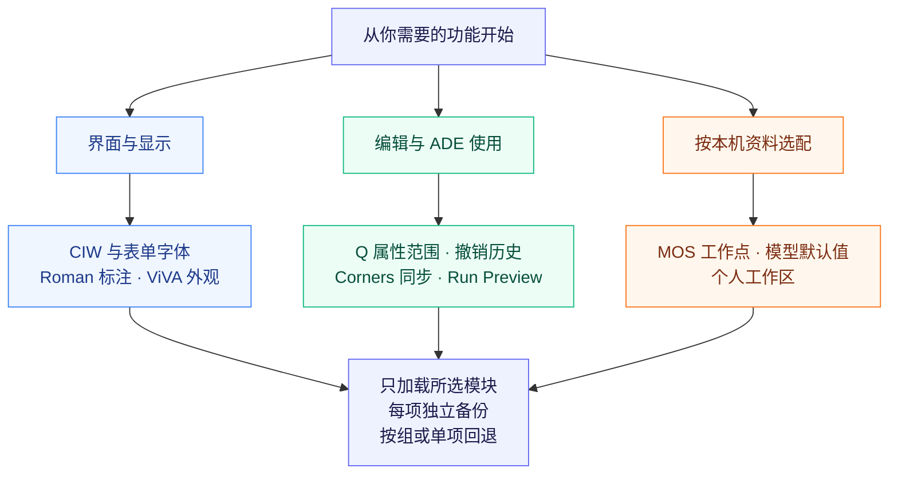
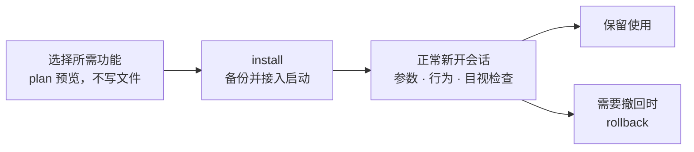
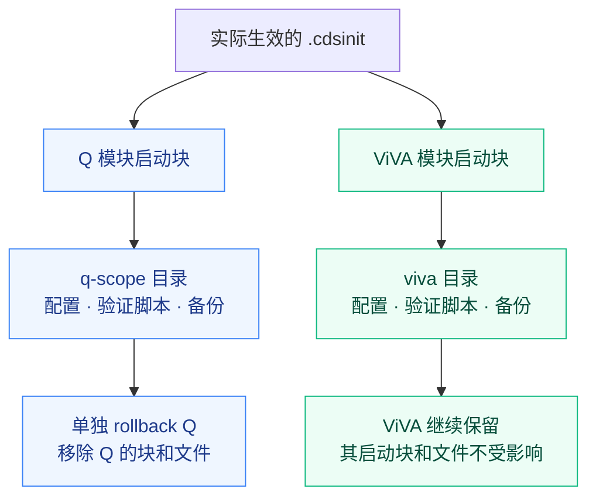

# Virtuoso User Config

**按功能选配的 Cadence Virtuoso IC6.1.8 用户配置：界面、波形、工作点和 ADE，一项一项装，也能一项一项撤回。**

[](https://github.com/w1213ph/virtuoso-user-config/actions/workflows/check.yml)

只想让 ViVA 变成白底？只想多选器件后按 Q 查看属性？只想补全 MOS 工作点气泡？从下面选对应模块即可。每项都能使用独立安装目录、备份和回退记录，也可以把仓库交给 AI，按你的选择配置。

- **从一个需求开始**：10 个功能模块任选，不要求整套安装。
- **在自己的环境使用**：通用显示设置可直接选配；工艺相关信息由本机提供。
- **配置后有路可退**：独立安装、自动备份，分别保留或撤回所选功能。
- **自己操作或交给 AI**：同一套命令和操作说明，两种上手方式。

[功能一览](#功能一览) · [快速开始](#快速开始) · [独立安装与回退](#独立安装与回退) · [交给 AI 配置](#交给-ai-配置) · [详细功能手册](docs/FEATURES.md)

## 适合谁

| 使用者 | 可以从哪里开始 |
| --- | --- |
| 日常使用 Virtuoso 的模拟 / RF IC 设计者 | 先选 ViVA、Q 属性范围或 MOS 工作点，解决手边的具体问题 |
| 课程、实验室和团队中配置新环境的人 | 使用相同模块清单，为各自本机安装可复用的偏好设置 |
| 希望让 AI 协助配置的用户 | 复制[交接提示](#交给-ai-配置)，明确要选的功能和验收方式 |

## 这个项目能做什么



所有模块都保持现有快捷键。配置不会批量改写已有原理图、版图或标签，也不改器件参数和仿真求解精度。模型模块只为新 ADE 会话设置本机提供的默认模型清单。

## 功能一览

### 界面与显示

| 模块 ID | 配置后能看到什么 | 适合什么情况 |
| --- | --- | --- |
| [`ciw`](docs/FEATURES.md#ciw) | CIW 使用 mono、字号 18；命令输入区为 12 行 | CIW 命令与日志太小，输入区域不够用 |
| [`form-fonts`](docs/FEATURES.md#form-fonts) | 全局表单 label/text 使用 11，保留旧式表单的正常间距 | Direct Plot 单选项、文字或边框挤在一起 |
| [`labels`](docs/FEATURES.md#labels) | 后续标注使用 Roman；部分默认字高 0.05；标注数字位数 6 | 希望新建原理图、符号、版图标签风格一致 |
| [`viva`](docs/FEATURES.md#viva) | 白底、1200×700 默认窗口、中等实线；19 类 Roman 文字；常用标记 4 位有效数字 | 希望波形、图例和标记更适合阅读与导图 |

### 编辑与 ADE 使用

| 模块 ID | 配置后能做什么 | 保留的原有行为 |
| --- | --- | --- |
| [`q-scope`](docs/FEATURES.md#q-scope) | 多选器件后按 Q，默认范围为 `all selected` | `same master` 筛选与原 Q 快捷键保留 |
| [`undo-history`](docs/FEATURES.md#undo-history) | 显示原理图 Undo/Redo History，方便回看编辑历史 | 不启用“保存后撤销” |
| [`ade-ui`](docs/FEATURES.md#ade-ui) | Corners Setup 同步相关增删；默认显示 Run Preview | 不自动 Refresh，不改 corner 内容或运行点勾选 |

### 工作点、模型与工作区

| 模块 ID | 配置后的效果 | 需要准备什么 |
| --- | --- | --- |
| [`op-annotations`](docs/FEATURES.md#op-annotations) | MOS 画布最多显示 5 项 DC 数据，气泡保留 10 项；参数、模型、DC 模式仍能切换 | 默认支持包内 analogLib 清单；工艺器件需本机清单及实际 DC 数据 |
| [`ade-models`](docs/FEATURES.md#ade-models) | 按设计实际关联的技术库路径，为新 ADE 选择模型默认值 | 本机模型映射 JSON：技术库路径、模型文件、section |
| [`workspace`](docs/FEATURES.md#workspace) | 从本机 Basic 模板创建 `Design_Default`，设为 Schematics 默认工作区 | 本机 `Basic.workspace`；不分发供应商模板 |

另有 [`bin/virtuoso-unscaled`](docs/FEATURES.md#unscaled)：只在本次启动清除继承的 `QT_SCALE_FACTOR`，用于排查原理图画布裁切，不修改 shell 或全局缩放。

> **只需要某一项，就明确写 `--features 模块ID`。** 省略时默认启用 `recommended`，即前七项；`all` 还需要模型映射和工作区模板。高级依赖见[功能手册](docs/FEATURES.md)。

## 快速开始

运行环境：Linux、已安装并授权的 Virtuoso IC6.1.8、Python 3.6+。安装器仅使用 Python 标准库。以下命令在 sh/bash 终端执行。

### 1. 获取项目

```sh
git clone https://github.com/w1213ph/virtuoso-user-config.git
cd virtuoso-user-config
```

也可在 GitHub 选择 **Code → Download ZIP**，解压后进入目录。后续命令均从仓库根目录执行。

### 2. 选一个功能并预览

以 **只配置 Q 属性范围** 为例。`plan` 列出目标文件和内容哈希，不写文件：

```sh
python3 install.py plan --features q-scope \
  --root "$HOME/.cadence/virtuoso-user-config/q-scope" \
  --cdsinit "$HOME/.cdsinit"
```

`--root` 是本组配置的独立目录；`--cdsinit` 是实际生效的启动文件。工程有自己的入口时，先看[多工程入口](#多工程入口)。初次使用建议按 [AI 操作流程](docs/AI_HANDOFF.md)先在专用测试目录演练安装与回退。

### 3. 安装，再正常新开会话

确认目标后，用相同参数执行 `install`：

```sh
python3 install.py install --features q-scope \
  --root "$HOME/.cadence/virtuoso-user-config/q-scope" \
  --cdsinit "$HOME/.cdsinit"
```

安装器备份原内容，在指定 `.cdsinit` 追加本组启动块，生成配置及检查脚本。它不关闭、重载或注入现有会话；请自行选择保存工作并正常新开会话的时机。



### 4. 验证效果

在新会话 CIW 加载本组生成的脚本：

```skill
load(strcat(getShellEnvVar("HOME") "/.cadence/virtuoso-user-config/q-scope/verify.il"))
```

`VUC_VERIFICATION_FAILURES=0` 表示所选环境参数及检查项通过。再在专用测试库中多选器件、按 Q，检查 `all selected` 和 `same master`，关闭表单后重开。

参数、实际行为和 GUI 目视检查分别记录。其他功能验收见 [验证清单](docs/VALIDATION.md)。

## 独立安装与回退

### 一个功能一个目录，才能分别撤回

Q 模块装好后，若还需要 ViVA，使用另一个 `--root`。先把下列命令的 `install` 换为 `plan` 预览，再安装：

```sh
python3 install.py install --features viva \
  --root "$HOME/.cadence/virtuoso-user-config/viva" \
  --cdsinit "$HOME/.cdsinit"
```

两者共用启动文件，各自维护自己的块和备份：



只检查或撤回 Q 模块：

```sh
python3 install.py status --root "$HOME/.cadence/virtuoso-user-config/q-scope"
python3 install.py rollback --root "$HOME/.cadence/virtuoso-user-config/q-scope"
```

回退保留其他模块及后来追加的无关启动内容。受管理文件或启动块被修改时，回退整体停止并提示冲突；备份 `.install.json` 留在本机。运行中的会话不强制改变，下次正常启动才获得撤回后的状态。

### 合并安装与独立安装有什么区别

| 目标 | 选择方式 | 回退单位 |
| --- | --- | --- |
| 只要一项 | `--features q-scope`，一个专用 `--root` | 这一项 |
| 多项需要分别保留或撤回 | 每次一个 ID，每次不同 `--root` | 每项单独回退 |
| 一组功能始终一起使用 | `--features ciw,labels,viva`，共用 `--root` | 整组一起回退 |
| 一次启用前七项 | `--features recommended` | 本次安装的整组 |

**合并安装中的单项不能直接单独卸载。** 如需拆分，先按组回退，再分别安装。各示例为不同选择；不要重复装相同功能。安装器会拒绝重复功能或非空安装目录。

## 按场景选功能

| 需求 | 选择模块 | 说明 |
| --- | --- | --- |
| 只调整波形外观 | `viva` | 不要求配置模型映射 |
| CIW 看清楚，表单不挤压 | `ciw`、`form-fonts` | 分别处理 CIW 和全局表单 |
| 统一后续标注和波形字体 | `labels`、`viva` | 已有设计标签不批量改写 |
| 多选看属性，回看编辑历史 | `q-scope`、`undo-history` | 原快捷键保留 |
| MOS 画布看五项，气泡看更多 | `op-annotations` | 需实际 DC 数据与器件清单 |
| 多套 PDK 下新 ADE 模型不串用 | `ade-models` | 按实际技术库路径匹配，不猜工艺版本 |

多个 ID 可分别安装，也可用逗号合并；是否需要分别回退决定安装方式。设置值、工作点字段与限制见[功能手册](docs/FEATURES.md)。

## 多工程入口

Virtuoso 读取哪份 `.cdsinit` 取决于启动目录和站点设置。工程有自己的入口时，仅修改用户目录可能不生效。确认后，可为同一组配置重复指定文件：

```sh
python3 install.py plan --features q-scope \
  --root "$HOME/.cadence/virtuoso-user-config/q-scope" \
  --cdsinit "$HOME/.cdsinit" \
  --cdsinit "$HOME/my-project/.cdsinit"
```

目标父目录必须存在。`-nocdsinit` 会跳过启动块；新建工程启动文件也可能遮蔽站点初始化。安装器保留原入口内容，不推断站点或 PDK 加载顺序。

## 交给 AI 配置

把仓库链接或完整项目交给 AI，并明确模块。例如：

```text
请先读本项目的 AGENTS.md、README.md 和 docs/AI_HANDOFF.md。
我只想启用 q-scope 和 viva，不启用其他功能。
请检查我的 Virtuoso 版本和实际 .cdsinit 入口，保留已有配置及快捷键。
两项分别使用独立 --root，先在测试目录演练安装、验证和回退。
不要关闭或注入已有会话，不要改 PDK、仿真设置或真实设计。
完成后报告实际文件、验证结果和每项功能的回退命令。
```

[AI 交接说明](docs/AI_HANDOFF.md)给出完整流程，[AGENTS.md](AGENTS.md)规定操作边界。没有 Virtuoso 或 GUI 时，只报告已做的静态/参数检查，不能宣称本机行为与视觉效果已验收。

## 已验证到哪一步

| 检查 | 结果 | 范围 |
| --- | --- | --- |
| 安装器测试 | Linux 12 项全过；Windows 11 项过、1 项跳过 | 安装、独立回退、冲突保护等；Windows 跳过符号链接权限测试 |
| 单模块加载与回退 | 十模块分别通过 | 隔离目录、IC6.1.8 新进程 |
| 多入口参数检查 | 六入口各 55 项通过 | 与同操作基线比较，无新增规范化诊断 |
| 移植后的 ADE L 模型行为 | 三种技术关联、手动与保存状态保留通过 | 专用测试库，共五项断言 |
| 全模块 GUI 目视验收 | 本发布版未全部重做 | 历史图形证据与本次加载证据分别记录 |

详见 [当前状态](CURRENT_STATE.md)、[验证摘要](validation/release-checks.json)与[验证方法](docs/VALIDATION.md)。既有 PDK 初始化问题保留在基线中；这些结果不代表所有版本、全部 PDK 或所有 ADE 流程均通过。

## 常见问题

**会覆盖原 `.cdsinit` 吗？** 保留原内容并追加唯一标记块，安装前保存备份。现有快捷键、第三方工具初始化及真实设计不批量重写。

**为什么表单字体没有一起放大？** 旧式表单有固定布局。历史上 label=14/text=15 会使 Direct Plot 重叠，所以 `form-fonts` 保持 11/11。CIW 可独立用字号 18。

**为什么不默认启用 Qt 缩放？** 历史上 1.2 倍缩放在特定 VNC 环境造成原理图底部裁切。这里提供可选、不改全局设置的[启动脚本](docs/FEATURES.md#unscaled)。

**为什么 MOS 没显示十项？** 画布受符号位置数限制，气泡取决于已保存的工作点字段、器件清单和 Show Balloons。analogLib 通常只能常驻前三项。[排查方法](docs/FEATURES.md#op-annotations)。

**能直接用任意 PDK 吗？** 外观模块不需要模型映射；工艺工作点及模型模块需要本机授权 PDK 的实际信息。仓库不附带模型或规则。

**支持保存后撤销、自动生成 Maestro 模板吗？** 当前没有启用这两项。撤销历史不等于保存后撤销；Maestro 模板仍需具体测试与信号。

## 文档导航与许可

| 文档 | 什么时候看 |
| --- | --- |
| [功能手册](docs/FEATURES.md) | 各模块设置值、效果、依赖与限制 |
| [高级配置](docs/ADVANCED.md) | 填器件/模型 JSON，配置本机工作区 |
| [AI 交接](docs/AI_HANDOFF.md) | 把项目交给 AI 按需配置 |
| [验证方法](docs/VALIDATION.md) | 区分参数、行为和 GUI 检查 |
| [全部改动整理](docs/CHANGES.md) | 历史修复、撤回方案与未实现项 |
| [发布与隐私](docs/PUBLISHING.md) | 维护或二次开源 |

欢迎通过 [Issues](https://github.com/w1213ph/virtuoso-user-config/issues)反馈问题、提出功能建议，或分享在其他版本上的验证结果。描述软件版本、模块 ID、重现步骤及已完成的验证层次，方便其他用户复现；本机连接资料、PDK 文件与实际设计数据请保留在本机。

采用 [Apache-2.0](LICENSE)，保留 [NOTICE](NOTICE)。早期偏好参考 [YiDingg 的初始化文章](https://github.com/YiDingg/YiDingg/blob/main/AnalogIC/Use%20Virtuoso%20Efficiently%20-%201.%20Shortcuts%20and%20Initialization.md)，之后按 IC6.1.8 实测修订。项目独立于 Cadence，不包含供应商软件、模型、规则、二进制模板或实际电路数据。
