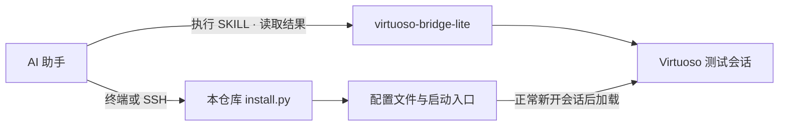

# AI 配置 Virtuoso

用 AI 调整 Virtuoso 的 ViVA、字体、器件属性和 ADE 设置。这里整理了 10 项配置，每项都可以单独安装、验证和回退。

AI 与 Virtuoso 的连接使用 [Arcadia-1/virtuoso-bridge-lite](https://github.com/Arcadia-1/virtuoso-bridge-lite)。本仓库提供配置文件和操作说明，桥接项目提供执行 SKILL、读取会话结果的通道。

把仓库交给 AI，可以这样说：

```text
帮我配置 Virtuoso：ViVA 改成白底，Q 属性窗口默认查看全部选中器件。
通过 virtuoso-bridge-lite 连接我的测试会话，先读取现有设置。
只启用 viva 和 q-scope，分开安装，保留原快捷键。
完成后验证效果，并给出各自的回退命令。
```

[连接方法](docs/CONNECT.md) · [完整功能](docs/FEATURES.md) · [手动安装](docs/INSTALL.md) · [给 AI 的提示](docs/AI_HANDOFF.md)

## 能改什么

| 功能 | 配置后的效果 | 模块 |
| --- | --- | --- |
| ViVA 波形 | 白底、中等实线、Roman 字体；常用标记 4 位有效数字 | `viva` |
| Q 属性窗口 | 默认 `all selected`，保留 `same master` 筛选 | `q-scope` |
| MOS 工作点 | 画布最多显示 id、vgs、vds、vth、gm；气泡最多保留 10 项 | `op-annotations` |
| CIW | mono 字体、字号 18，输入区 12 行 | `ciw` |
| 表单字体 | label/text 使用 11，修复单独放大字体造成的布局挤压 | `form-fonts` |
| 新建标注 | 原理图、符号、版图相关标注默认 Roman | `labels` |
| 撤销历史 | 显示 Undo/Redo History | `undo-history` |
| ADE 界面 | Corners Setup 同步相关增删，默认显示 Run Preview | `ade-ui` |
| 新 ADE 模型 | 按技术库实际路径选择对应模型默认清单 | `ade-models` |
| 工作区 | 从本机 Basic 模板创建 Schematics 个人工作区 | `workspace` |

工作点显示取决于符号位置数和实际保存的仿真数据；工艺器件清单、模型映射及工作区模板需要从本机提供。各项设置值和限制见[功能手册](docs/FEATURES.md)。

## AI 怎么连接 Virtuoso



桥接读取和验证会话里的设置；`install.py` 把选中的配置写入 Linux 用户目录，并保留备份。安装脚本可以独立使用，桥接不会随安装器自动启用。

### 1. 先接通 bridge

按 [virtuoso-bridge-lite 的连接说明](https://github.com/Arcadia-1/virtuoso-bridge-lite/blob/main/skills/virtuoso/references/connection.md)安装和配置，在 AI 所在机器启动桥接。远程模式需要先能通过 SSH 登录 Virtuoso 主机。

```sh
virtuoso-bridge init your-user@your-server
virtuoso-bridge start
```

将示例账号和主机名换成自己的。把 `start` 输出的完整 `load("...")` 命令贴到指定测试会话的 CIW 中，再检查：

```sh
virtuoso-bridge status
virtuoso-bridge eval '1+2'
```

收到成功结果并返回 `3`，说明 SKILL 请求已到达会话。完整步骤、Windows 用法和常见连接问题见 [CONNECT.md](docs/CONNECT.md)。

### 2. 让 AI 读取本项目

```sh
git clone https://github.com/w1213ph/virtuoso-user-config.git
```

把项目目录或仓库链接交给能执行终端命令的 AI 助手，并让它先读 [AGENTS.md](AGENTS.md)。说明要开哪些功能、使用哪份启动文件；首页开头的提示就可以作为例子。

AI 先在测试目录生成候选配置，通过 bridge 检查加载结果，再安装到实际入口。配置包与安装器需要放到 Virtuoso 所在的 Linux 用户环境，桥接客户端则可以在另一台机器上。

## 独立安装与回退

想分别撤回，就把每个模块装到不同目录。例如，在 Virtuoso 所在的 Linux 环境中只预览 Q 属性配置：

```sh
python3 install.py plan --features q-scope \
  --root "$HOME/.cadence/virtuoso-user-config/q-scope" \
  --cdsinit "$HOME/.cdsinit"
```

确认后将 `plan` 换为 `install`。撤回这一项：

```sh
python3 install.py rollback \
  --root "$HOME/.cadence/virtuoso-user-config/q-scope"
```

`q-scope,viva` 共用一个目录属于合并安装，回退时会一起撤回。只要一项功能时明确写 `--features`；省略它会选择默认的七项配置。[完整安装与验证步骤](docs/INSTALL.md)。

## 使用前了解

配置在 IC6.1.8 上测试。安装器要求 Linux / Python 3.6+；bridge 客户端的 Python 与依赖要求按其上游项目执行。现有快捷键保持原样，已有标签、真实设计和仿真精度不批量改写。

本包没有启用“保存后撤销”，也没有生成通用 Maestro 波形模板。模型与工作点功能需要使用者自己的授权 PDK 信息。参数检查通过与实际行为、图形验收分别记录，详见[验证说明](docs/VALIDATION.md)及[当前状态](CURRENT_STATE.md)。

## 文档与来源

- [连接 Virtuoso](docs/CONNECT.md)：安装 bridge、加载 CIW、检查连通性。
- [功能手册](docs/FEATURES.md)：十项配置的效果、设置值与限制。
- [手动安装](docs/INSTALL.md) / [高级配置](docs/ADVANCED.md)：安装、回退、多工程入口及本机 PDK 输入。
- [AI 交接说明](docs/AI_HANDOFF.md)：可复制的提示与操作步骤。
- [改动记录](docs/CHANGES.md) / [隐私与发布](docs/PUBLISHING.md)。

连接能力来自 [virtuoso-bridge-lite](https://github.com/Arcadia-1/virtuoso-bridge-lite)。早期界面偏好参考 [YiDingg 的初始化文章](https://github.com/YiDingg/YiDingg/blob/main/AnalogIC/Use%20Virtuoso%20Efficiently%20-%201.%20Shortcuts%20and%20Initialization.md)。本仓库采用 [Apache-2.0](LICENSE)，出处见 [NOTICE](NOTICE)；不包含 Cadence 软件、PDK 模型或实际电路。
