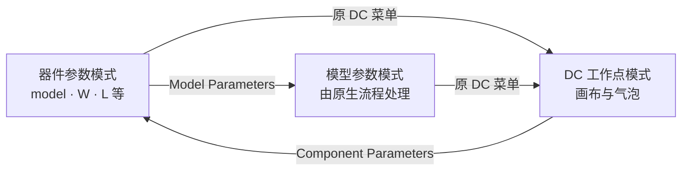
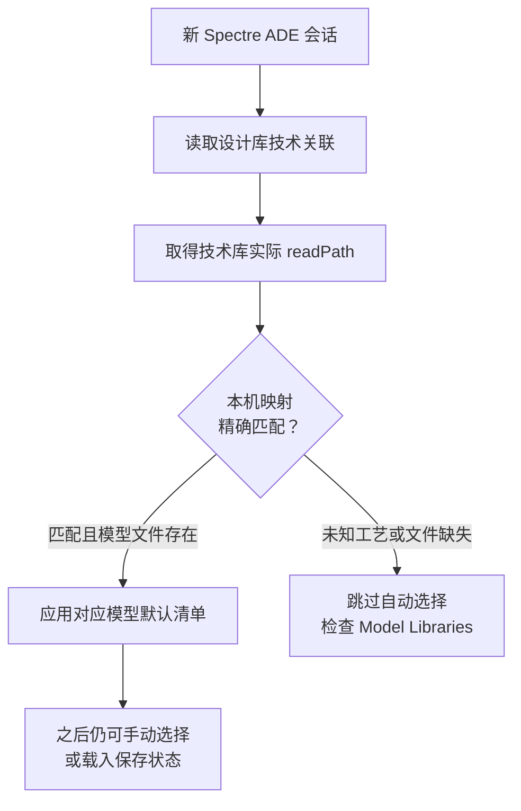

# 功能手册

[返回首页](../README.md) · [高级输入示例](ADVANCED.md) · [行为与图形验收](VALIDATION.md)

本页按实际模块解释“改什么、需要什么、怎么检查”。设置来自 `features/*.cdsenv`、`install.py` 与 `skill/` 模板；图示是配置逻辑，不是软件截图或性能仿真结果。

## 先选安装方式

每项都可用 `--features 模块ID` 选择。**需要分别回退，就使用不同 `--root` 分别安装。** 逗号组合写入同一个安装组，之后按整组回退。不要求把其他模块一起安装。

| 输入 | 实际选择 |
| --- | --- |
| `--features viva` | 只选择 ViVA 外观 |
| `--features q-scope,viva` | Q 和 ViVA 合为一组 |
| `--features recommended` 或省略 | ciw、form-fonts、labels、viva、q-scope、undo-history、ade-ui |
| `--features all` | 十项；需模型映射和工作区模板 |
| `--op` | 在已选功能外追加 op-annotations；并非“只选工作点” |
| `--models 文件` | 提供本机映射并追加 ade-models |
| `--workspace-template 文件` | 提供本机模板并追加 workspace |

只想工作点，应写 `--features op-annotations`，而不是省略 `--features` 后单独写 `--op`。

<a id="ciw"></a>
## 1. CIW：命令与日志更易读

模块：`ciw`。

| 设置 | 值 | 影响范围 |
| --- | --- | --- |
| 字体 | `mono` | CIW |
| 字号 | `18`，非粗体、非斜体 | CIW |
| 命令输入区 | `12` 行 | CIW 输入区域 |

适合放大命令与日志、保留更多输入空间。不调整表单字体、波形字体或远程桌面分辨率。检查新 CIW 的可读性与输入区大小。

<a id="form-fonts"></a>
## 2. 表单字体：保留固定布局的正常间距

模块：`form-fonts`。

| 类别 | 设置 |
| --- | --- |
| `label` | 字号 11，非粗体、非斜体 |
| `text` | 字号 11，非粗体、非斜体 |

用于恢复旧式表单合适字号，不把全局文字单独放大。历史上 label=14/text=15 曾使 Direct Plot 的文字、单选项和边框重叠。CIW 放大使用独立的 `ciw`。

验收时打开 Direct Plot 检查标签、输入框、表格与单选项，同时检查原理图画布完整性。字体 API 返回值不能代替排版目视检查。

<a id="labels"></a>
## 3. Roman 标签：统一后续标注风格

模块：`labels`。

| 对象 | 默认设置 |
| --- | --- |
| 原理图新建标签、实例标注、注释 | `roman` |
| 符号标签、引脚标签 | `roman`，启用引脚独立字体样式 |
| 原理图新建标签、符号标签 | 字高 `0.05` |
| 版图新建标签 | `roman` |
| `auCore.misc labelDigits` | `6` |

影响之后新建或重新生成的相关标注，不遍历改写已有设计文字。显示位数不等于仿真精度。请在专用测试原理图、符号和版图分别新建标注验证。

<a id="viva"></a>
## 4. ViVA：白底、统一字体与标记格式

模块：`viva`。

| 视觉内容 | 默认设置 |
| --- | --- |
| 波形绘图区与框架 | 白色背景 |
| 新波形窗口 | `1200 × 700` |
| 波形线条 | `medium`、`solid` |
| 标题 / 坐标轴 / 图例 | Roman；字体描述字号字段 10 / 12 / 8 |
| 标记、图内文字与网格等 | Roman；合计 19 类字体默认值 |
| 点、水平、垂直标记数字 | Manual，4 位有效数字 |
| 水平、垂直、参考线标记 | interceptStyle 为 on |
| 绘图显示资源开关 | `asimenv.plotting useDisplayDrf = nil` |

19 类包含标题、坐标轴、图例；水平/垂直/参考线/交点标记；点/参考点/规格/圆形/多差值/过渡沿标记；图内标签；极坐标/Smith 网格；区域/X 范围/Y 范围书签。

只改显示默认值，不改仿真信号、频率、数值数据或精度。已有波形窗口可能保留自己的状态，请新建窗口检查背景、图例、字体、线条及标记。

<a id="q-scope"></a>
## 5. Q 属性窗口：默认处理选中对象

模块：`q-scope`。

| 部位 | 配置后 |
| --- | --- |
| 属性范围 | `all selected` |
| 对象筛选 | 保留原有 `same master` |
| 打开方式 | 保留原 Q 快捷键 |

适合多选同类器件后查看属性。`all selected` 不取消 `same master` 筛选，也不自动修改器件参数。请在测试原理图单选、多选后按 Q，检查字段并重开表单；跨 master 的处理仍受原筛选控制。

<a id="undo-history"></a>
## 6. 撤销历史：查看已有编辑记录

模块：`undo-history`。

启用 `schematic showUndoRedoHistoryInEditor = t`，显示 Undo/Redo History。请在测试库做一次可逆编辑，再撤销与重做，检查记录。

**不启用“保存后撤销”。** `dbUndoAcrossSave` 没有被本包设置，不能从历史面板可见推断保存后的编辑仍可撤销。

<a id="ade-ui"></a>
## 7. ADE 偏好：同步 Corner 窗口、显示运行预览

模块：`ade-ui`。

| 设置 | 作用 | 边界 |
| --- | --- | --- |
| `autoCornerUpdate = t` | Corners Setup 同步相关增删 | 不改 corner 内容或模型 |
| `outputTabsShowDefault` 包含 Run Preview | 默认显示运行点预览页 | 不自动 Refresh，不改运行点勾选 |

在专用 ADE 中打开 Corners Setup，再增删测试 corner；检查 Run Preview 是否显示。历史主要完成参数加载检查，目标环境的交互与视觉效果仍须实际确认。

<a id="op-annotations"></a>
## 8. MOS 工作点：画布看常用值，气泡看完整字段

模块：`op-annotations`。

初始仍显示器件参数。点击原 DC Operating Points 菜单后才应用扩展规则；切回 Component Parameters 时恢复参数模式。



| 字段 | 含义简述 | 显示安排 |
| --- | --- | --- |
| `id` | 漏极电流 | 有符号位置时常驻画布；气泡保留 |
| `vgs` | 栅源电压 | 同上 |
| `vds` | 漏源电压 | 同上 |
| `vth` | 阈值电压 | 同上 |
| `gm` | 跨导 | 同上 |
| `region` | 模型定义的工作区代码 | 气泡 |
| `gmoverid` | gm/Id 字段 | 气泡 |
| `rout` | 输出电阻字段 | 气泡 |
| `ron` | 导通电阻字段 | 气泡 |
| `cgg` | 总栅电容字段 | 气泡 |

字段名称、符号、定义及数值以实际模型为准，没有保存的数据不会由本包补算或伪造。模型参数模式仍使用原生处理，不承诺每个器件都有可见模型数值。

画布最多五项，还取决于符号的 `cdsParam` 位置数。默认 analogLib 符号通常只有三个位置，因此常驻前三项。气泡需开启 **File → Show Balloons**，仍为原生滚动列表。

工艺器件需填写本机库名、单元名和 `inline_slots`，见[器件清单](ADVANCED.md#mos-工作点)。本模块不改 Spectre save 设置，须先仿真并保存实际 DC 数据。因使用部分内部注释 API，其他版本需重新验证。

<a id="ade-models"></a>
## 9. ADE 模型默认值：按实际技术关联选择

模块：`ade-models`。

适合多个 PDK 初始化脚本抢写工具级 modelFiles 默认值的环境。不按库名猜工艺，按设计关联的技术库 `readPath` 精确匹配本机 JSON。



需提供技术库实际路径、模型文件绝对路径和 section；不同版本即使库名相同，也须分别对应。路径存在不等于 section、corner 或器件仿真正确。[JSON 示例与路径查询](ADVANCED.md#新-ade-模型默认值)。

只初始化 Spectre 新会话默认值，链式保留已有 session-init 函数。手动选择、保存状态和已有 corner 不批量重写。旧状态已保存错误模型时仍须另行处理。本版实际重验 ADE L 的三种技术关联和手动/保存状态保留，其他变体边界见[当前状态](../CURRENT_STATE.md)。

<a id="workspace"></a>
## 10. 个人工作区：从本机 Basic 模板开始

模块：`workspace`。

读取本机 `Basic.workspace`，生成 `Design_Default.workspace` 并设置 Schematics 的 `workspace.default` 指针。便于在个人副本中继续保存 Navigator、Property Editor 和常用面板布局；实际内容以本机 Basic 模板为准。

已有默认指针备份，同名目标工作区存在时拒绝覆盖。仅处理 Schematics，不设置 XL、Layout 或 Symbol，不在每次启动时覆盖后来保存的默认工作区。[本机模板参数](ADVANCED.md#工作区)。

<a id="unscaled"></a>
## 可选启动脚本：本次不继承 Qt 缩放

```sh
sh bin/virtuoso-unscaled
```

要求 `virtuoso` 已在 PATH 中，其他参数原样传递。只清除本次进程的 `QT_SCALE_FACTOR`，不写 shell 启动文件，不改远程桌面分辨率，也不保证修复所有图形问题。

应同时检查 Direct Plot 与原理图画布底部。特定 VNC 下 Qt 1.2 缩放导致裁切的历史见[改动记录](CHANGES.md)。

## 没有提供的功能

- 不提供 PDK、模型、规则、许可、Cadence 软件或实际电路数据。
- 不修改原快捷键、真实器件参数、仿真精度或真实设计。
- 不启用保存后撤销，不自动创建通用 Maestro 波形模板。
- 不批量重写已有标签、已保存 ADE 模型状态或已有 corner。

[回到安装与回退示例](../README.md#独立安装与回退)
