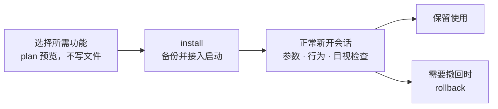
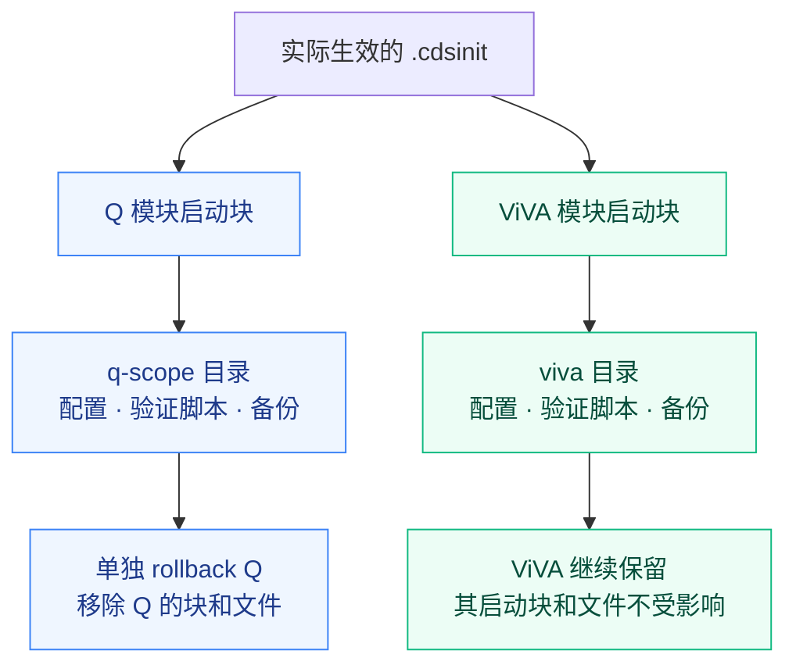

# 手动安装与回退

[返回首页](../README.md) · [通过 bridge 连接](CONNECT.md) · [功能手册](FEATURES.md)

安装器运行在 Virtuoso 所在的 Linux 环境，要求 Python 3.6+。命令也可以由 AI 通过已配置的终端或 SSH 执行；桥接主要用于读取和验证会话内的设置。

## 快速开始

运行环境：Linux、已安装并授权的 Virtuoso IC6.1.8、Python 3.6+。安装器仅使用 Python 标准库。以下命令在 sh/bash 终端执行。

### 1. 获取项目

```sh
git clone https://github.com/w1213ph/virtuoso-user-config.git
cd virtuoso-user-config
```

也可在 GitHub 选择 **Code → Download ZIP**，解压后进入目录。后续命令均从仓库根目录执行。

### 2. 选一个功能并预览

以 **只配置 Q 属性范围** 为例。`plan` 列出目标文件和内容哈希，不写文件：

```sh
python3 install.py plan --features q-scope \
  --root "$HOME/.cadence/virtuoso-user-config/q-scope" \
  --cdsinit "$HOME/.cdsinit"
```

`--root` 是本组配置的独立目录；`--cdsinit` 是实际生效的启动文件。工程有自己的入口时，先看[多工程入口](#多工程入口)。初次使用建议按 [AI 操作流程](AI_HANDOFF.md)先在专用测试目录演练安装与回退。

### 3. 安装，再正常新开会话

确认目标后，用相同参数执行 `install`：

```sh
python3 install.py install --features q-scope \
  --root "$HOME/.cadence/virtuoso-user-config/q-scope" \
  --cdsinit "$HOME/.cdsinit"
```

安装器备份原内容，在指定 `.cdsinit` 追加本组启动块，生成配置及检查脚本。它不关闭、重载或注入现有会话；请自行选择保存工作并正常新开会话的时机。



### 4. 验证效果

在新会话 CIW 加载本组生成的脚本：

```skill
load(strcat(getShellEnvVar("HOME") "/.cadence/virtuoso-user-config/q-scope/verify.il"))
```

`VUC_VERIFICATION_FAILURES=0` 表示所选环境参数及检查项通过。再在专用测试库中多选器件、按 Q，检查 `all selected` 和 `same master`，关闭表单后重开。

参数、实际行为和 GUI 目视检查分别记录。其他功能验收见 [验证清单](VALIDATION.md)。

## 独立安装与回退

### 一个功能一个目录，才能分别撤回

Q 模块装好后，若还需要 ViVA，使用另一个 `--root`。先把下列命令的 `install` 换为 `plan` 预览，再安装：

```sh
python3 install.py install --features viva \
  --root "$HOME/.cadence/virtuoso-user-config/viva" \
  --cdsinit "$HOME/.cdsinit"
```

两者共用启动文件，各自维护自己的块和备份：



只检查或撤回 Q 模块：

```sh
python3 install.py status --root "$HOME/.cadence/virtuoso-user-config/q-scope"
python3 install.py rollback --root "$HOME/.cadence/virtuoso-user-config/q-scope"
```

回退保留其他模块及后来追加的无关启动内容。受管理文件或启动块被修改时，回退整体停止并提示冲突；备份 `.install.json` 留在本机。运行中的会话不强制改变，下次正常启动才获得撤回后的状态。

### 合并安装与独立安装有什么区别

| 目标 | 选择方式 | 回退单位 |
| --- | --- | --- |
| 只要一项 | `--features q-scope`，一个专用 `--root` | 这一项 |
| 多项需要分别保留或撤回 | 每次一个 ID，每次不同 `--root` | 每项单独回退 |
| 一组功能始终一起使用 | `--features ciw,labels,viva`，共用 `--root` | 整组一起回退 |
| 一次启用前七项 | `--features recommended` | 本次安装的整组 |

**合并安装中的单项不能直接单独卸载。** 如需拆分，先按组回退，再分别安装。各示例为不同选择；不要重复装相同功能。安装器会拒绝重复功能或非空安装目录。


## 多工程入口

Virtuoso 读取哪份 `.cdsinit` 取决于启动目录和站点设置。工程有自己的入口时，仅修改用户目录可能不生效。确认后，可为同一组配置重复指定文件：

```sh
python3 install.py plan --features q-scope \
  --root "$HOME/.cadence/virtuoso-user-config/q-scope" \
  --cdsinit "$HOME/.cdsinit" \
  --cdsinit "$HOME/my-project/.cdsinit"
```

目标父目录必须存在。`-nocdsinit` 会跳过启动块；新建工程启动文件也可能遮蔽站点初始化。安装器保留原入口内容，不推断站点或 PDK 加载顺序。
